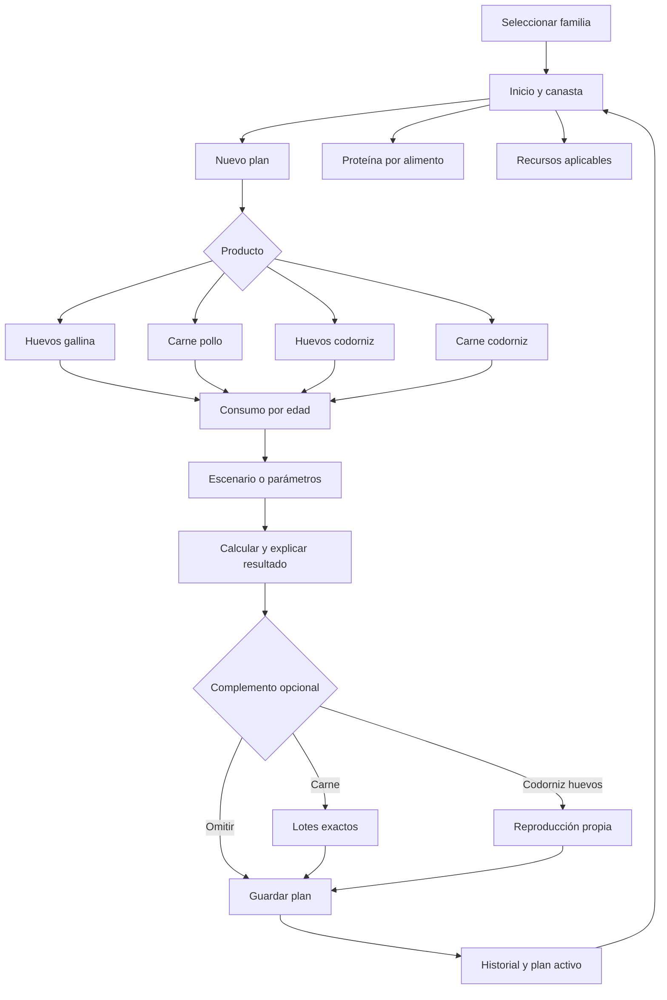

# Planificador Avícola Familiar — Base de conocimiento del equipo
**Versión de la documentación:** 3.1 — línea base de desarrollo · **Fecha:** 14 de noviembre de 2026  
**Equipo:** 3 integrantes · **Producto:** aplicación Android móvil offline-first · **Estado:** decisiones cerradas para implementar, pruebas de app pendientes.

> **Cómo usar estos archivos:** este `.md` es la documentación maestra para personas. El `.json` complementario es un **grafo dirigido de propiedades**: contiene nodos, relaciones y catálogos de los mismos elementos para asistentes, búsqueda semántica o importación a una base de grafos. Modifiquen ambos cuando cambie la línea base.

## Índice
- [1. Resumen y alcance](#1-resumen-y-alcance)
- [2. Versiones V1 y V2](#2-versiones-v1-y-v2)
- [3. Decisiones adoptadas por el equipo](#3-decisiones-adoptadas-por-el-equipo)
- [4. Diez módulos y funcionalidades](#4-diez-módulos-y-funcionalidades)
- [5. Modelos matemáticos y parámetros](#5-modelos-matemáticos-y-parámetros)
- [6. Flujos de usuario y navegación](#6-flujos-de-usuario-y-navegación)
- [7. Requerimientos funcionales](#7-requerimientos-funcionales)
- [8. Requerimientos no funcionales](#8-requerimientos-no-funcionales)
- [9. Modelo de datos y arquitectura](#9-modelo-de-datos-y-arquitectura)
- [10. Grafo de conocimiento JSON](#10-grafo-de-conocimiento-json)
- [11. División de trabajo (3 integrantes)](#11-división-de-trabajo-3-integrantes)
- [12. Pruebas de aceptación](#12-pruebas-de-aceptación)
- [13. Roadmap e integración](#13-roadmap-e-integración)
- [14. UX/UI y diseño](#14-uxui-y-diseño)
- [15. Fuentes y trazabilidad](#15-fuentes-y-trazabilidad)
- [16. Riesgos y límites](#16-riesgos-y-límites)
- [17. Definición de terminado](#17-definición-de-terminado)

## 1. Resumen y alcance
El Planificador Avícola Familiar permite crear múltiples perfiles familiares en un mismo dispositivo y estimar aves necesarias para autoconsumo a partir de consumos editables. Los productos soportados son **huevos de gallina**, **carne de pollo**, **huevos de codorniz** y **carne de codorniz**. A partir de los resultados se pueden organizar lotes para carne, planificar reemplazos de codornices ponedoras, guardar planes, visualizar una canasta familiar y calcular aporte de proteína informativo. El módulo de recursos completa la planificación de manera progresiva.
**No está incluido en V1:** cuentas, login, roles distintos, backend, nube, sincronización, comercio electrónico, seguimiento real automatizado de producción, recomendaciones médicas o prescripciones veterinarias. Los PDF entregados son modelos didácticos y los ejemplos no constituyen recomendaciones dietarias universales.
**Aclaración clave:** los audios contienen recomendaciones atribuidas al profesor que evaluará la aplicación. Se tomaron en cuenta al priorizar la V1, pero **las decisiones de implementación D-01 a D-08 ahora las adopta el equipo**, no quedan bloqueadas esperando otra aprobación.

## 2. Versiones V1 y V2
| Entrega | Incluye | Restricciones |
| --- | --- | --- |
| **V1.0 evaluación** | M01–M06, M08, M10, RF-51; M07 básico condicionado a referencia aplicable | 43 RF (incluyendo 3 marcados V1*); offline; valores de ejemplo fieles a PDF; no inventar cifras técnicas |
| **V2.0 ampliación** | M07 completo (agua, espacio, equipo, costos por etapa), M09, respaldo opcional | 8 RF diferidos; requiere nuevas referencias, validaciones y soporte por sistema de crianza |
**Alcance de desarrollo**: las animaciones de integrar familiares, canasta y proteína son parte de V1. Las operaciones de nutrientes muestran aporte de alimento, nunca porcentaje universal de cobertura nutricional.

## 3. Decisiones adoptadas por el equipo
Todas las decisiones antiguamente «para definir con el profesor» se resuelven aquí como reglas internas. Si el evaluador pide un cambio, abrir una propuesta de cambio, incrementar `formulaVersion`/`documentVersion` y actualizar pruebas golden, datos y pantallas; **no cambiar constantes silenciosamente**.
### D-01 · Semanas por año
**Decisión del equipo:** 52 semanas para el cálculo anual de carne (versionado como calendar_weeks=52); no usar 52.14 en V1.
**Motivo:** Reproduce exactamente los ejemplos oficiales de los tres PDF. Cambiarlo rompe algunos resultados golden.

### D-02 · Postura 75 %
**Decisión del equipo:** La primera versión conserva los escenarios documentados: gallina 0.57/0.70/0.82 y codorniz 0.60/0.68/0.82. NO sustituirlos por 0.75.
**Motivo:** El 75 % apareció en un comentario oral sin asociarse inequívocamente con una especie o sustituir la tabla de escenarios. Se privilegia trazabilidad matemática.

### D-03 · Grupos de edad y menores de 4
**Decisión del equipo:** Capturar grupos 0–3, 4–8, 9–13, 14–18 y 19+ años. Para 0–3 no mostrar porciones predeterminadas; solo consumos explícitamente introducidos por quien planifica, y sin recomendaciones dietarias.
**Motivo:** Evita edades solapadas, registra a toda la familia y no extrapola porciones infantiles ausentes en los PDF.

### D-04 · Parámetros fijos y editables
**Decisión del equipo:** V1: U=0.95 fijo en huevos, seguridad 0.15 en gallina y 0.10 en otros ejemplos, escenarios de postura/rendimiento/mortalidad predefinidos. Editables: consumos, composición, lotes y las tasas reproductivas explícitas (0<r<=1). No exponer modo avanzado de tasas productivas en V1.
**Motivo:** Reduce errores y conserva los resultados de los PDF sin impedir capturar condiciones reproductivas medidas.

### D-05 · Canasta familiar y planes activos
**Decisión del equipo:** Solo un plan activo por familia y por producto entre hen_eggs,chicken_meat,quail_eggs,quail_meat; activación transaccional. Reproducción es subplan vinculado, NO alimento. La canasta representa PRODUCCIÓN PLANIFICADA, no inventario real.
**Motivo:** Evita doble conteo y mantiene el historial de escenarios alternativos.

### D-06 · Alcance de recursos
**Decisión del equipo:** V1: vista de recursos y cálculo de alimento SOLO si existe referencia aplicable por especie y etapa, con procedencia visible; si no, mostrar "estimación no disponible". V2: agua, espacio, comederos, bebederos, costos y ciclos detallados. Nunca confundir aves por año con aves presentes.
**Motivo:** Evita ofrecer estimaciones engañosas para líneas o alojamientos no documentados.

### D-07 · Datos nutricionales y barra de proteína
**Decisión del equipo:** Valores ilustrativos trazables a los PDF: huevo gallina ~6.5 g/unidad; huevo codorniz ~1.54 g/unidad; pollo cocido 28.9 g/100 g; codorniz cocida 25.1 g/100 g. Mostrar gramos y visualización animada con escala informativa; nunca 100 g diarios como meta universal ni porcentaje de necesidad.
**Motivo:** Las referencias de composición están expresadas por unidad y/o 100 g; las necesidades humanas son individuales.

### D-08 · Plataforma, compatibilidad y respaldo
**Decisión del equipo:** V1 Android, React Native + TypeScript y SQLite local, sin login, backend ni nube. Meta de compatibilidad Android 10+ (a verificar al seleccionar SDK). Sin sincronización; la exportación/restauración manual se programa para V2, con aviso visible sobre riesgo de pérdida de datos por desinstalación.
**Motivo:** Reduce complejidad y mantiene la condición offline; los objetivos de compatibilidad se validan en dispositivos reales.

## 4. Diez módulos y funcionalidades
| ID | Módulo | Versión | Responsabilidad |
| --- | --- | --- | --- |
| M01 | Gestión de familias | V1 | Perfiles, edad, selección, edición, archivo; interfaz inclusiva. |
| M02 | Planificación de producción | V1 | Cuatro modelos: huevos gallina, carne pollo, huevos codorniz, carne codorniz. |
| M03 | Organización de lotes | V1 | Distribución numérica exacta de aves para carne. |
| M04 | Reproducción de codornices | V1 | Reemplazos opcionales y huevos fértiles estimados. |
| M05 | Planes e historial | V1 | Guardado, versión, activación, duplicado, filtros y eliminación. |
| M06 | Canasta de producción familiar | V1 | Vista derivada de planes activos, sin doble conteo. |
| M07 | Recursos de producción | V1_básico_y_V2_completo | Estimaciones situadas de alimento, agua, alojamiento, equipo y presupuesto. |
| M08 | Aportación nutricional informativa | V1 | Proteína por porción, sin evaluar necesidades individuales. |
| M09 | Recomendaciones y bioseguridad | V2 | Guías con fuentes, registros sanitarios, sin prescripción automática. |
| M10 | Configuración, ayuda y accesibilidad | V1 | Explicaciones, trazabilidad, etiquetas de accesibilidad, estados. |
**M07** en V1 no debe prometer una estimación universal: un plan puede mostrar «Referencia no disponible para esta especie/etapa». **M09** queda para V2, aunque V1 puede incluir un mensaje general de bioseguridad sin simular diagnósticos.

## 5. Modelos matemáticos y parámetros
### 5.1 Contratos de entrada, unidades y redondeo
- Huevos: consumo en **unidades por persona por ocasión**, frecuencia **ocasiones/día**, **días/semana** (0–7), resultado **huevos/semana** y aves enteras.
- Carne: **gramos de carne cocida comestible por persona por ocasión**, después kg/semana y kg/año. La **canal/peso vivo** no equivale a carne cocida comestible.
- Tasas se muestran en % en pantalla, pero internamente se representan como proporciones de 0 a 1. Los rendimientos de carne están en kg/ave.
- **52 semanas/año**; redondeo `ceil` por etapa de sacrificio e inicio; se conserva el valor completo en cálculos intermedios.
- Demanda cero => cero aves; validadores rechazan divisor cero, consumo negativo y días >7.

| Fórmula | Descripción | Operación | Salida | Referencia |
| --- | --- | --- | --- | --- |
| F01 | Demanda semanal de huevos | E_sem = Σ_i(N_i · H_i · F_i · D_i) | eggs/week | SRC-F1, SRC-F3 |
| F02 | Cantidad de ponedoras | G = ceil(E_sem · (1+S) / (7 · P · U)) | laying_females | SRC-F1, SRC-F3 |
| F03 | Demanda semanal de carne cocida | M_sem = Σ_i(N_i · M_i · F_i · D_i)/1000 | kg/week | SRC-F2, SRC-F3 |
| F04 | Demanda anual de carne | M_year = M_sem · 52 | kg/year | SRC-F2, SRC-F3 |
| F05 | Aves para consumo | A_slaughter = ceil(M_year · (1+S)/Y) | birds_to_slaughter | SRC-F2, SRC-F3 |
| F06 | Aves iniciales (redondeo segundo) | A_initial = ceil(A_slaughter/(1-m)) | birds_started | SRC-F2, SRC-F3 |
| F07 | Huevos fértiles a incubar | H = ceil(R/(f·h·s·p_female)) | eggs_to_incubate | SRC-F3 |
| F08 | Distribución exacta de aves por lotes | base=floor(A_initial/L); remainder=A_initial mod L; lote_j=base+(j<=remainder?1:0) | array of birds/lots; sum == A_initial | SRC-F2, SRC-F3, SRC-R1 |
| F09 | Alimento según presencia y edad | Feed_kg = Σ_days[N_present_day·C_g_per_bird_day]/1000 | kg for period | SRC-C1, SRC-EXT-HYLINE, SRC-EXT-ROSS, SRC-EXT-QUAIL |
| F10 | Espacio del alojamiento | Space_m2 = N_present·m2_per_bird | m2 | SRC-EXT-UMN, SRC-EXT-QUAIL |
| F11 | Cantidad de equipos | Equipment = ceil(N_present / documented_capacity_per_equipment) | pieces | SRC-C1, SRC-EXT-UMN, SRC-EXT-ROSS |
| F12 | Costo estimado | Cost = feed_kg·price_per_kg + Σ_equipment(qty·price_each) | MXN or specified currency | SRC-C1, SRC-R1 |
| F13 | Proteína aproximada aportada | Protein_g = eggs·protein_g_per_egg OR meat_g·protein_g_per_100g/100 | g of estimated protein | SRC-F1, SRC-F2, SRC-F3 |

### 5.2 Valores de referencia incorporados
**Gallinas ponedoras, PDF base (`PARAM-HEN`):**
Postura: conservative = 57% (ejemplo: 20 aves), intermediate = 70% (ejemplo: 16 aves), good_management = 82% (ejemplo: 14 aves). Aprovechamiento 95%, seguridad 15%.

**Codornices ponedoras, PDF base (`PARAM-QUAIL`):**
Postura: conservative = 60% (ejemplo: 26 aves), intermediate = 68% (ejemplo: 23 aves), good_management = 82% (ejemplo: 19 aves). Aprovechamiento 95%, seguridad 10%.

**Pollos carne, PDF base (`PARAM-CHICKEN-MEAT`):**
fast_growing: 1.2 kg comestibles/ave, mortalidad 5%, 66 para consumo, 70 iniciales; slow_growing: 0.75 kg comestibles/ave, mortalidad 10%, 106 para consumo, 118 iniciales. Seguridad 10%.

**Codorniz carne, PDF base (`PARAM-QUAIL-MEAT`):**
reference: 0.14 kg comestibles/ave, mortalidad 8%, 176 para consumo, 192 iniciales. Seguridad 10%.

**Reproducción de codorniz, ejemplo (`PARAM-QUAIL-BREED`):**
Para 10 hembras: fertilidad 80%, incubabilidad 75%, supervivencia 90%, proporción hembras 50% → 38 huevos. Tasas reproductivas son editables.

### 5.3 Familia del ejemplo de los PDF (no es el tamaño obligatorio del usuario)
**Cinco personas:** 2 adultos, 2 adolescentes y 1 niño del grupo 4–8 años. Resultados de demanda de ejemplo: 63 huevos de gallina/semana; 92 huevos de codorniz/semana; 1.38 kg de carne de pollo/semana; 0.43 kg de carne de codorniz/semana. Una familia de 6 personas se captura normalmente, pero no reproduce automáticamente los mismos oráculos.

### 5.4 Recursos y nutrición
**Alimento:** V1 solo cuando existe referencia por especie y etapa aplicable: `Σ(avesPresentes_día × gramosPorAve_día)/1000`. Por ejemplo, 16 gallinas × 115 g/día = 1.84 kg/día y 23 codornices × 25 g/día = 0.575 kg/día: ambos son **ejemplos condicionados a la referencia y al manejo**, no raciones universales. Para pollos de engorda usar tablas **por edad**, no valor diario único.
**V2:** agua orientativa, espacio según alojamiento, equipamiento según ficha técnica, costos ingresados por el usuario, lotes que realmente coinciden en una fecha y registros de sanidad. El agua siempre debe estar disponible; una estimación de consumo nunca significa suministro máximo permitido.

| Alimento | Referencia de proteína | Presentación | Procedencia |
| --- | --- | --- | --- |
| Huevos de gallina | 6.5 | g_protein_per_egg | SRC-F1 |
| Huevos de codorniz | 1.54 | g_protein_per_egg | SRC-F3 |
| Carne de pollo | 28.9 | g_protein_per_100g_cooked | SRC-F2 |
| Carne de codorniz | 25.1 | g_protein_per_100g_cooked | SRC-F3 |
**Uso de barra animada:** representar un total estimado en gramos de la porción introducida, con escala informativa claramente rotulada; **no mostrar porcentaje de una meta diaria universal ni una silueta llena al 100 % de las necesidades humanas**. Reducir movimiento si así lo solicita el sistema.

## 6. Flujos de usuario y navegación
La navegación principal contiene solo **Inicio / Familias / Mis planes**. El resto es contextual; esto sigue la propuesta Violet UI elegida.


**Estados de interfaz obligatorios:** vacío (sin familias/planes), calculando, resultados, error de entrada, confirmar eliminación/archivo, sin referencia técnica, animaciones con alternativa estática, selección de plan activo. Prototipo Figma ≠ funcionalidad implementada.

## 7. Requerimientos funcionales
Los siguientes **51 RF** son los requisitos de la especificación anterior. Se conserva el ID para trazabilidad; las decisiones D-01 a D-08 ya están resueltas arriba como línea base del equipo.
### M01 — Gestión de familias
| ID | Descripción verificable | Entrega |
| --- | --- | --- |
| RF-01 | Crear múltiples perfiles familiares con nombre identificador y número de integrantes por grupo de edad. | V1 |
| RF-02 | Editar nombre y composición familiar sin modificar el registro histórico de cálculos previamente guardados. | V1 |
| RF-03 | Seleccionar una familia activa; los cálculos nuevos y planes se asociarán exclusivamente a ese perfil. | V1 |
| RF-04 | Archivar y restaurar familias mediante confirmación, sin perder los planes asociados. | V1 |
| RF-05 | Modificar integrantes mediante botones +/− o introducción numérica directa; actualizar inmediatamente los totales y rechazar números negativos. | V1 |

### M02 — Planificación de producción
| ID | Descripción verificable | Entrega |
| --- | --- | --- |
| RF-06 | Permitir elegir huevos de gallina, carne de pollo, huevos de codorniz o carne de codorniz. | V1 |
| RF-07 | Capturar por grupo de edad: cantidad por persona y ocasión, ocasiones por día y días por semana; los consumos permanecerán editables. | V1 |
| RF-08 | Calcular demanda semanal de huevos de gallina y número de ponedoras mediante postura, aprovechamiento y margen de seguridad. | V1 |
| RF-09 | Calcular demanda semanal y anual de carne de pollo, aves para consumo y pollitos iniciales considerando rendimiento, margen y mortalidad. | V1 |
| RF-10 | Calcular demanda semanal de huevos de codorniz y hembras ponedoras requeridas. | V1 |
| RF-11 | Calcular demanda anual de carne de codorniz, aves para consumo y aves iniciales considerando rendimiento y mortalidad. | V1 |
| RF-12 | Ofrecer escenarios de producción predefinidos por especie; mantener visibles las tasas y su condición de valores de referencia. | V1 |
| RF-13 | Mostrar resultado, unidad, periodo, escenario, supuestos y explicación de las operaciones utilizadas. | V1 |
| RF-14 | Comparar escenarios manteniendo idéntica demanda familiar para que solo cambien los parámetros productivos pertinentes. | V1 |
| RF-15 | Validar rangos, divisores, unidades y decimales; aplicar redondeos según el modelo y bloquear resultados matemáticamente inválidos. | V1 |

### M03 — Organización de lotes
| ID | Descripción verificable | Entrega |
| --- | --- | --- |
| RF-16 | Ofrecer la organización opcional en lotes al terminar un cálculo de pollos o codornices para carne. | V1 |
| RF-17 | Permitir elegir un número entero válido de lotes y distribuir las aves iniciales entre ellos. | V1 |
| RF-18 | Mostrar aves por lote y garantizar que la suma sea idéntica al total de aves iniciales; evitar duplicaciones por redondeo. | V1 |
| RF-19 | Guardar lotes asociados al plan; explicar que la distribución numérica no constituye un calendario ni determina aves simultáneas. | V1 |

### M04 — Reproducción de codornices
| ID | Descripción verificable | Entrega |
| --- | --- | --- |
| RF-20 | Ofrecer reproducción opcional después del cálculo de codornices ponedoras, sin imponerla al usuario. | V1 |
| RF-21 | Solicitar cantidad deseada de hembras de reemplazo y tasas de fertilidad, incubabilidad, supervivencia y proporción de hembras. | V1 |
| RF-22 | Calcular huevos fértiles a incubar según la ecuación del documento de codornices, con redondeo al entero superior. | V1 |
| RF-23 | Guardar el resultado reproductivo vinculado al plan de ponedoras y advertir que es una estimación sujeta al manejo real. | V1 |

### M05 — Planes e historial
| ID | Descripción verificable | Entrega |
| --- | --- | --- |
| RF-24 | Guardar plan con nombre, familia, producto, consumos, parámetros, resultados, fecha y versión del modelo de cálculo. | V1 |
| RF-25 | Consultar historial solo de la familia activa, con filtros por producto y estado del plan. | V1 |
| RF-26 | Abrir un plan y consultar resultados, supuestos, lotes, cálculos y recursos disponibles vinculados. | V1 |
| RF-27 | Duplicar un plan para recalcular una nueva versión sin sobrescribir el registro original. | V1 |
| RF-28 | Eliminar un plan mediante confirmación sin afectar otros planes ni el resto de las familias. | V1 |

### M06 — Canasta de producción familiar
| ID | Descripción verificable | Entrega |
| --- | --- | --- |
| RF-29 | Presentar una canasta visual por familia con los productos incluidos en sus planes activos. | V1 |
| RF-30 | Actualizar la canasta cuando se active, modifique o desactive un plan del producto correspondiente. | V1 |
| RF-31 | Mostrar cantidades con sus unidades y periodos: huevos por semana, carne por semana y/o año, sin mezclar unidades. | V1 |
| RF-32 | Evitar sumar planes alternativos de un mismo producto; distinguir producción planeada de cosecha o producción realmente obtenida. | V1 |

### M07 — Recursos de producción
| ID | Descripción verificable | Entrega |
| --- | --- | --- |
| RF-33 | Habilitar una vista de recursos contextual a cada plan de producción. | V1* |
| RF-34 | Estimar alimento diario o por ciclo usando número de aves presentes y tabla de consumo aplicable a su especie y etapa. | V1* |
| RF-35 | Estimar consumo orientativo de agua indicando condiciones de referencia; no establecer un límite de suministro. | V2 |
| RF-36 | Estimar superficie de alojamiento considerando especie, etapa y sistema de crianza declarado. | V2 |
| RF-37 | Estimar número de comederos y bebederos con base en capacidad o longitud de acceso documentadas para el equipo. | V2 |
| RF-38 | Estimar costo de alimento y equipamiento usando cantidades calculadas y precios introducidos por el usuario. | V2 |
| RF-39 | Distinguir aves permanentes, lotes activos y reproductores, sin confundir total anual con aves simultáneamente presentes. | V2 |
| RF-40 | Mostrar fuente, unidad, especie, etapa y supuestos de cada recurso; si faltan datos esenciales, indicar que no hay estimación válida. | V1* |

### M08 — Aportación nutricional informativa
| ID | Descripción verificable | Entrega |
| --- | --- | --- |
| RF-41 | Calcular proteína estimada aportada por porciones de huevos o carne seleccionadas mediante datos nutricionales identificados. | V1 |
| RF-42 | Mostrar aporte numérico por porción y periodo, con una visualización comprensible, sin equipararlo automáticamente al requerimiento total. | V1 |
| RF-43 | Informar alimento, cantidad, unidad y fuente de composición; no fijar metas universales de proteína ni emitir diagnósticos nutricionales. | V1 |

### M09 — Recomendaciones y bioseguridad
| ID | Descripción verificable | Entrega |
| --- | --- | --- |
| RF-44 | Consultar recomendaciones documentadas de higiene, alimento, agua, alojamiento y observación de aves. | V2 |
| RF-45 | Registrar actividades sanitarias, revisiones y vacunaciones indicadas para una parvada. | V2 |
| RF-46 | Mostrar orientación para obtener apoyo veterinario, sin prescribir un calendario universal de vacunación. | V2 |

### M10 — Configuración, ayuda y accesibilidad
| ID | Descripción verificable | Entrega |
| --- | --- | --- |
| RF-47 | Consultar las fórmulas y el significado de sus variables desde la pantalla correspondiente. | V1 |
| RF-48 | Mostrar unidades, fuentes y versión de los valores técnicos predefinidos utilizados. | V1 |
| RF-49 | Ofrecer ayudas contextuales, estados vacíos, mensajes de error claros y confirmaciones para acciones importantes. | V1 |
| RF-50 | Proporcionar etiquetas para lectores de pantalla, orden de navegación lógico y preferencias de accesibilidad pertinentes. | V1 |

### Transversal — animaciones
**RF-51 (V1):** Incorporar animaciones breves y significativas al agregar/quitar integrantes, actualizar la canasta y representar el aporte de proteína; sincronizarlas con los datos reales y respetar movimiento reducido.

## 8. Requerimientos no funcionales
| ID | Categoría | Criterio verificable |
| --- | --- | --- |
| RNF-01 | Disponibilidad offline | Crear familias, calcular, guardar y consultar planes V1 con el dispositivo en modo avión. |
| RNF-02 | Persistencia | Los registros confirmados sobreviven al cierre forzoso y reinicio de la aplicación. |
| RNF-03 | Integridad | Guardar, duplicar y eliminar deben ser operaciones coherentes: no dejar registros parciales. |
| RNF-04 | Minimización de datos | No solicitar cuenta, contraseña ni nombres individuales de integrantes cuando no son necesarios. |
| RNF-05 | Seguridad de datos | Almacenar información en el espacio privado de la app; no incluir datos familiares en registros de depuración. |
| RNF-06 | Exactitud matemática | Aprobar el 100 % de los casos de prueba matemáticos pactados antes de la entrega. |
| RNF-07 | Precisión y redondeo | Preservar precisión durante las operaciones; redondear en cada etapa indicada por el modelo, no antes. |
| RNF-08 | Tiempo de cálculo | Objetivo: cálculo local finalizado en menos de 1 s en el dispositivo de referencia, con carga normal. |
| RNF-09 | Inicio de la app | Objetivo: mostrar inicio utilizable en menos de 3 s en el dispositivo de referencia. |
| RNF-10 | Capacidad local | Probar al menos 20 familias y 200 planes sin fallos ni degradación perceptible. |
| RNF-11 | Accesibilidad visual y motriz | Aplicar criterios pertinentes de WCAG 2.2 AA, contraste y áreas táctiles adecuadas; respetar movimiento reducido. |
| RNF-12 | Lectores de pantalla | Proporcionar nombre, estado y propósito a controles; presentar resultados con unidades y orden lógico de lectura. |
| RNF-13 | Usabilidad | Meta de prueba: al menos 4 de 5 usuarios representativos completan familia y plan básico sin ayuda externa. |
| RNF-14 | Compatibilidad | Declarar y verificar versión mínima de Android, resoluciones y dispositivos soportados antes de la liberación. |
| RNF-15 | Mantenibilidad y pruebas | Separar cálculo, vistas, datos y referencias; versionar modelos y automatizar pruebas unitarias. |
| RNF-16 | Trazabilidad científica | Cada parámetro predeterminado o consejo técnico registrará fuente, especie, etapa, unidad y versión. |
**Métricas previstas, no medidas aún:** cálculo <1 s, arranque <3 s, 20 familias/200 planes y 4 de 5 usuarios completando flujo; hay que ensayarlas en dispositivos de referencia. No afirmar validación de software antes de ejecutar las pruebas.

## 9. Modelo de datos y arquitectura
### 9.1 Arquitectura acordada
- **Android / React Native / TypeScript / SQLite local.** Sin cuentas, contraseña, backend ni nube en V1.
- **Capas:** `presentation` → `application/usecases` → `domain/calculators` → `data/repositories` → `data/sqlite`. Inyección de dependencias para separar la lógica de la navegación y permitir pruebas puras.
- La app utiliza `formulaVersion = avicola-1.0.0` y copia completa de entradas y parámetros en cada plan. Los cambios posteriores crean nuevas versiones; no se recalculan planes antiguos sin una acción explícita.
- **Contratos:** ver catálogo `architecture` y `database_entities` del JSON. Unidades internas precisas; fechas ISO; tasas fraccionarias; identificadores UUID; migraciones SQLite.
- **Git:** `main` estable, `develop` integración, ramas `feature/<modulo>-<tarea>`, revisión cruzada de pull requests antes de fusionar.

### 9.2 Entidades principales propuestas
| Tabla | Campos y restricciones clave | Entrega |
| --- | --- | --- |
| families | id TEXT PK, name TEXT, archived INTEGER, created_at, updated_at | V1 |
| family_age_counts | family_id FK, group_key CHECK, quantity INTEGER >=0, composite PK | V1 |
| plans | id UUID PK, family_id FK, product_code, name, status, model_version, inputs_json, params_json, results_json, source_refs_json, created_at | V1 |
| consumption_lines | id, plan_id FK, age_group, people, portion_qty, portion_unit, occasions_per_day, days_per_week | V1 |
| plan_lots | id, plan_id FK, lot_index, birds_planned INTEGER, UNIQUE(plan_id,lot_index) | V1 |
| quail_reproduction_plans | id, parent_plan_id FK, desired_females, fertility, hatchability, survival, female_ratio, eggs_to_incubate | V1 |
| active_product_plans | family_id FK, product_code, plan_id FK, PRIMARY KEY(family_id,product_code) | V1 |
| plan_resource_estimates | id, plan_id FK, reference_id, type, stage, birds_present, result, units, applicability, estimation_version | V1_básico |
| technical_references | reference_id PK, name, kind, document_or_url, species, life_stage, valid_from, version, notes | V1 |
| food_protein_reference | food_code, serving_basis, protein_value_g, source_id, state, version | V1 |
| sanitation_records | id, family_id FK, lot_id nullable, activity, local_date, instructions_provenance, notes | V2 |
**Modelo de canasta:** preferir **vista derivada** sobre `active_product_plans` + `plans`, sin duplicar cantidades en otra tabla. `active_product_plans` garantiza `(family_id, product_code)` único; cambiar de plan activo es operación transaccional. Registro de reproducción ligado a plan de codornices ponedoras.

### 9.3 Ejemplo de estructura del repositorio
```text
planificador-avicola/
├─ src/
│  ├─ presentation/       # pantallas, componentes, animaciones, navegación
│  ├─ application/        # casos de uso: crear plan, activar plan, etc.
│  ├─ domain/             # entidades, reglas, validadores, calculadoras TS
│  ├─ data/               # SQLite, migraciones, repositorios, catálogo
│  ├─ common/             # utilidades, unidades, errores tipados
│  └─ assets/             # iconos e ilustraciones autorizadas
├─ tests/
│  ├─ unit/
│  ├─ integration/
│  └─ acceptance/
└─ docs/
   ├─ Planificador_Avicola_Conocimiento_Completo.md
   └─ Planificador_Avicola_Grafo_Conocimiento.json
```

## 10. Grafo de conocimiento JSON
El archivo **`Planificador_Avicola_Grafo_Conocimiento.json`** contiene los arreglos `graph.nodes` y `graph.edges` más `catalogs` normalizados. Es un **property graph dirigido**; se puede cargar con un script en Neo4j, NetworkX, herramientas RAG, un indexador, o visualizar mediante un conversor a Mermaid. El JSON NO crea ni ejecuta una base de grafos por sí mismo.
**Tipos de nodo:** proyecto, versión, módulo, producto, fuente, fórmula, parámetros, requisito funcional/no funcional, caso de aceptación, decisión, regla de negocio, entidad de base de datos, pantalla, diseño, arquitectura, rol de integrante, hito y riesgo.
**Relaciones:** `contains_module`, `specifies`, `uses_formula`, `derived_from`, `validates`, `scheduled_for`, `owns_entity`, `renders_screen`, `adopts_decision`, `affects`, `leads`, `precedes`, `navigates_to`, etc.
```json
{
  "source": "RF-08",
  "relation": "uses_formula",
  "target": "F02"
}
```
En este ejemplo, el RF-08 utiliza la fórmula F02 de cálculo de ponedoras. A su vez, F02 tiene conexiones a F1 y F3 y a otros RF.

## 11. División de trabajo (3 integrantes)
Asignación **propuesta** por responsabilidad; los nombres de las personas pueden sustituir las etiquetas «Integrante 1/2/3». Los tres deben revisar PR de otros módulos y participar en pruebas.
### Integrante 1 — UI/UX y app móvil
- **Lidera:** M01, M06, M10.
- **Apoya:** M08.
- Navegación y pantallas React Native
- Familias y formularios
- Canasta y animaciones
- Accesibilidad y estilos
- Integrar lógica desde interfaces tipadas
**Entrega principal:** componentes reutilizables; rutas y navegación; pantallas de estado; animaciones con movimiento reducido.

### Integrante 2 — cálculos y reglas de negocio
- **Lidera:** M02, M03, M04, M08.
- **Apoya:** M07.
- Motor matemático puro, independiente de RN
- Escenarios por especie y parámetros versionados
- Lotes, reproducción y validadores
- Aporte nutricional
- Recursos V1 con fuentes
- Pruebas unitarias CP01–CP19
**Entrega principal:** funciones TS probadas; parámetros y oráculos golden; README técnico de ecuaciones; paquete domain.

### Integrante 3 — datos e integración/QA
- **Lidera:** M05, M07.
- **Apoya:** M01, M06, M10.
- SQLite, esquema y migraciones
- Repositories y transacciones
- Historial y planes activos
- Conectar UI/dominio/persistencia
- Pruebas de integración, offline, datos y release Android
**Entrega principal:** base local y migraciones; repositories; pruebas de integración; APK de evaluación y guía de instalación.

**Contratos de integración:** Integrante 2 exporta funciones puras tipadas, por ejemplo `calculateHens`, `calculateChickenMeat`, `calculateQuailEggs`, `calculateQuailMeat`, `calculateQuailBreeding`, `distributeLots` y `calculateProtein`. Integrante 3 publica interfaces `FamilyRepository`/`PlanRepository`/`ReferenceRepository` y migraciones; Integrante 1 utiliza estos contratos desde componentes y casos de uso, sin replicar fórmulas.
**Ritmo sugerido:** reunión breve al inicio del trabajo semanal; PR pequeño con prueba; validación de integración al cerrar cada hito. No inventar fechas límite: el equipo puede ponerlas en su tablero.

## 12. Pruebas de aceptación
**Estado:** resultados esperados comprobados matemáticamente en el documento original; tests aún **no ejecutados** contra la aplicación. Las pruebas de nutrición y de interfaz se ensayarán con valores y animaciones reales.
| Caso | Entrada o situación | Comportamiento esperado |
| --- | --- | --- |
| CP-01 | Gallinas · postura conservadora | 20 gallinas |
| CP-02 | Gallinas · postura intermedia | 16 gallinas |
| CP-03 | Gallinas · buen manejo | 14 gallinas |
| CP-04 | Pollos · engorda rápida | 66 aves para consumo; 70 pollitos iniciales |
| CP-05 | Pollos · crecimiento lento | 106 aves para consumo; 118 iniciales |
| CP-06 | Codorniz ponedora · conservador | 26 hembras |
| CP-07 | Codorniz ponedora · intermedio | 23 hembras |
| CP-08 | Codorniz ponedora · buen manejo | 19 hembras |
| CP-09 | Codorniz para carne | 176 aves para consumo; 192 iniciales |
| CP-10 | Reproducción: 10 reemplazos, tasas del ejemplo | 38 huevos a incubar |
| CP-11 | 70 pollitos / 6 lotes | 12, 12, 12, 12, 11 y 11 |
| CP-12 | 192 codornices / 6 lotes | 6 lotes de 32 |
| CP-13 | Postura 0 con demanda positiva | Se bloquea cálculo y se indica motivo |
| CP-14 | Rendimiento comestible 0 | Se impide división entre cero |
| CP-15 | Mortalidad 100 % | Se impide calcular aves iniciales |
| CP-16 | Días por semana mayores a 7 | Se rechaza el dato |
| CP-17 | Integrantes negativos | No se permite almacenar |
| CP-18 | Fertilidad/incubabilidad 0 con reemplazos positivos | Se bloquea el cálculo reproductivo |
| CP-19 | Consumo total 0 | Resultado 0; no se generan lotes vacíos |
| CP-20 | Dos planes de un mismo producto | Un plan activo; alternativas conservadas |
| CP-21 | Reinicio tras guardar | Datos confirmados intactos |
| CP-22 | Modo avión | Cálculo y persistencia disponibles |
| CP-23 | Agregar/quitar integrante | Contador, figuras y total sincronizados |
| CP-24 | Activar/desactivar plan | Canasta y productos animados correctamente; alternativa sin animación |
| CP-25 | Actualizar porción | Aporte de proteína y barra cambian juntos, sin indicar meta universal |
### Oráculos de prueba con entradas completas
- **Gallina huevos:** familia 2 adultos×2 huevos + 2 adolescentes×2 + 1 niño×1, 1 ocasión/día y 7 días/semana → **63 huevos/semana**. U=.95, S=.15, P=.57/.70/.82 → 20/16/14 ponedoras.
- **Pollo carne:** 2×100 g + 2×100 g + 1×60 g, 1 ocasión/día y 3 días/semana → 1.38 kg/semana y 71.76 kg/año. Y=1.20, S=.10, m=.05 → 66 consumo y 70 iniciales. Y=.75, S=.10, m=.10 → 106 y 118.
- **Codorniz huevos:** 2 adultos×5 + 2 adolescentes×5 + 1 niño×3, 1 ocasión/día y 4 días/semana → 92 huevos/semana. U=.95, S=.10, P=.60/.68/.82 → 26/23/19.
- **Codorniz carne:** 2 adultos×100 g + 2 adolescentes×90 g + 1 niño×50 g, 1 ocasión/día y 1 día/semana → 0.43 kg/semana, 22.36 kg/año. Y=.14, S=.10, m=.08 → 176 consumo y 192 iniciales.
- **Reproducción:** R=10 hembras, fertilidad .80, incubabilidad .75, supervivencia .90, hembras .50 → 38 huevos a incubar.
- **Lotes:** 70 aves y 6 lotes → [12,12,12,12,11,11]; 192 aves y 6 lotes → [32,32,32,32,32,32].

## 13. Roadmap e integración
| Hito | Objetivo | Evidencia de salida |
| --- | --- | --- |
| MS-01 | Base de ingeniería y contratos | compila Android, contratos de datos revisados, CI ejecuta pruebas vacías |
| MS-02 | Motor de cálculo probado | 12 ejemplos numéricos correctos, validaciones sin divisiones inválidas |
| MS-03 | Familias, planes y flujo integral | funciona offline, planes sobreviven reinicio, sin doble conteo de canasta |
| MS-04 | Comentarios de evaluación | RF-51 en 3 superficies, proveniencia visible, Reduce Motion soportado |
| MS-05 | Calidad y entrega V1 | CP01–CP25 aprobadas, sin defectos bloqueantes, instalación probada en móvil compatible |
| MS-06 | Ampliación V2 | fuentes aplicables incluidas, funciones V2 ensayadas |
**Dependencias:** M01 → M02 (familia activa y composición); M02 → M03/M04/M07/M08 (resultado técnico); M02+M05 → M06 (plan activo); M05 → historial/canasta; M10 cruza todas las pantallas. La canasta no debe calcularse a partir de tarjetas de UI sino desde los planes activos persistidos.

## 14. UX/UI y diseño
**Archivo Figma:** https://www.figma.com/design/yQkL35X9aG3ObwsDMt9uya/Planificador-Av%C3%ADcola.?node-id=125-508
**Propuesta elegida:** 03 · Propuesta Violet UI Studio. También existen 01 · Diseño Editorial, 02 · Propuesta alternativa — Phosphor UI como alternativas preservadas.
**Paleta elegida:**
| Token | Color | Uso |
| --- | --- | --- |
| Highlighter Yellow | #e4f222 | CTA, progreso y estado activo |
| Ink | #0c0a08 | texto principal |
| Obsidian | #1a1919 | navegación y resultados destacados |
| Paper | #ffffff | tarjetas y controles |
| Bone | #f4f2f0 | fondo general |
| Ash | #6d6c6b | texto secundario |
| Hairline | #e5e7eb | bordes y separadores |
| Smoke | #d3d3d3 | estados suaves y líneas secundarias |
Se diseñaron **92 vistas/variantes de prototipo**, con rutas para escenarios de producción, lotes y pantallas de error/ayuda. La versión final del archivo ha corregido rellenos de tarjetas y posición de los botones bajos. **Esto es una referencia visual y no código funcional**.
**Patrones UI:** selección de familia, tres pasos visibles de cálculo, resultados Obsidian, escenarios documentados, canasta de producción, accesos contextuales a fórmulas, confirmación de operaciones destructivas, estados sin datos y accesibilidad.

## 15. Fuentes y trazabilidad
| ID | Fuente | Qué respalda | Grado de verificación |
| --- | --- | --- | --- |
| SRC-F1 | Modelo de cálculo de gallinas de postura para autoconsumo de traspatio (`modelo_calculo_gallinas_postura_traspatio.pdf`) | Demanda semanal, P/U/S, gallinas, proteína del huevo, escenarios, validación en campo | source_read |
| SRC-F2 | Modelo de cálculo de pollos y gallinas para carne en traspatio (`modelo_calculo_pollos_gallinas_carne_traspatio.pdf`) | Carne semanal/anual, rendimiento, margen, mortalidad, lotes, proteína pollo cocido | source_read |
| SRC-F3 | Modelo de cálculo de codornices para huevo y carne (`modelo_calculo_codornices_huevo_carne_traspatio.pdf`) | Codorniz postura/carne, nutrición, lotes, reproducción ecuación 9 | source_read |
| SRC-C1 | Precio consumo y trastes pollos y codornices (`Precio consumo y trastes pollos y codornices.docx`) | Capturas de alimento, agua, espacio, equipos y precios para codornices y pollos | preliminary_only |
| SRC-R1 | Requerimientos funcionales y no funcionales de Planificador Avícola (`Planificador_Avicola_Requerimientos_Funcionales_No_Funcionales.docx`) | 51 RF, 16 RNF, 25 CP, versiones y decisiones previas | source_read |
| SRC-A1 | Audios y comentarios transmitidos del profesor evaluador | Canasta, animación de integrantes, barra proteína, grupos de edad, parámetros fijos, recursos y sanidad | user_provided_account |
| SRC-EXT-HYLINE | Hy-Line Brown Max — Performance Standards Guide (2025) | Consumo alimento y agua de línea comercial de gallinas ponedoras | prior_research_requires_applicability_check |
| SRC-EXT-ROSS | Aviagen Ross 308 Performance Objectives / Ross Management Handbook | Consumo de alimento por edad; agua; comederos; bebederos en broiler comercial | prior_research_requires_applicability_check |
| SRC-EXT-UMN | University of Minnesota Extension — Raising Chickens for Eggs | Traspatio, espacio, nidos, cuidado y acceso a equipos | prior_research_requires_applicability_check |
| SRC-EXT-QUAIL | Fuentes técnicas universitarias de producción de codornices | Porciones de alimento, densidades, diferencias por etapa y línea | prior_research_requires_applicability_check |
| SRC-EXT-SENASICA | SENASICA — Bioseguridad en aves de traspatio | Higiene, prevención y consulta veterinaria local | prior_research_requires_applicability_check |
| SRC-STD-WCAG | WCAG 2.2 AA (W3C) | Accesibilidad, contraste, lectores de pantalla y movimiento reducido | standard_reference |
| SRC-STD-MASVS | OWASP MASVS | Seguridad y almacenamiento móvil | standard_reference |
**Jerarquía de evidencia:** 1) los tres PDF para fórmulas y casos golden, 2) el documento de requisitos existente para contratos de entrega, 3) comentarios del profesor transmitidos por el compañero para UX/funciones de evaluación, 4) literatura externa para estimaciones de recursos y sanidad. Las decisiones D-01–D-08 son **acuerdos del equipo**, no ecuaciones extraídas de los PDF.

## 16. Riesgos y límites
| ID | Riesgo | Impacto | Mitigación |
| --- | --- | --- | --- |
| RISK-01 | Copiar 52.14 o 75 % sin versionar cambiaría resultados | alto | baseline D-01/D-02 y tests de regresión |
| RISK-02 | Confundir número anual de aves con inventario simultáneo | alto | RF-39 y cálculo por lote y edad |
| RISK-03 | Referencia de alimento/espacio de sistema distinto | alto | proveniencia/condiciones y no estimar si falta contexto |
| RISK-04 | Barra interpretada como cobertura nutricional universal | alto | mostrar gramos aportados, no 100% diario |
| RISK-05 | Pérdida de datos por desinstalación | medio | avisar en V1, diseñar export/import V2 |
| RISK-06 | Tres desarrolladores pisan los mismos archivos/cambios | medio | dueños de carpetas, PR y revisión cruzada |
| RISK-07 | Figma se confunde con aplicación funcional | medio | prototipo solo representación visual, cálculos se implementan en TS |
| RISK-08 | Demanda infantil tomada como dieta prescrita | alto | entradas del usuario, edades sin porciones predeterminadas, texto informativo |
**Limitaciones:** las producciones son proyecciones, no inventario cosechado; las pautas dietarias no sustituyen orientación nutricional profesional; sanidad no prescribe tratamientos; los valores del fabricante de una línea no extrapolan a todas las aves; las cifras de recursos requieren referencias aplicables; la desinstalación puede borrar datos locales en V1.

## 17. Definición de terminado
Un requisito se marca «terminado» solo si: (1) tiene implementación integrada, (2) valida datos, (3) tiene pruebas pertinentes, (4) cumple criterios de accesibilidad, (5) no rompe cálculos golden ni persistencia, (6) se revisó mediante PR y (7) se actualizó la documentación y el JSON.
**Checklist de aceptación de V1:**
- [ ] cuatro cálculos reproducen oráculos del PDF
- [ ] registrar varias familias por cinco grupos
- [ ] guardar y consultar sin internet
- [ ] escenarios e historial con un plan activo por producto
- [ ] lotes con suma exacta
- [ ] reproducción opcional de codornices
- [ ] canasta derivada, animada y sin doble conteo
- [ ] aporte de proteína en gramos (sin metas universales)
- [ ] animaciones RF-51 y alternativa Reduce Motion
- [ ] referencias y ayuda contextual visibles
- [ ] estimación de alimento solo cuando haya fuente aplicable
- [ ] 25 casos CP ejecutados y aprobados en app
- [ ] prueba de lectura de pantalla y flujo básico en Android real

---
**Generado:** 2026-11-14. **Autoría funcional:** síntesis de documentos aportados, conversaciones de diseño y decisiones adoptadas por el equipo. Para futuras revisiones, actualizar `metadata.version` y la correspondiente documentación.
